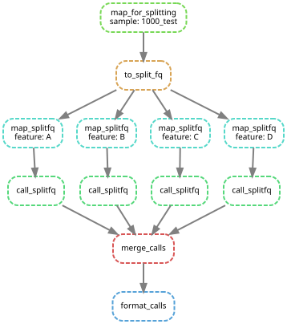

### Introduction
This pipeline uses existing tools and custom scripts to examine long DNA reads from repetitive regions for SV content.  It takes a fasta or fastq (.fa or .fq) of long reads as input.  For each read in the input, it outputs an entry in a feature calls file (.feat file).  Each feature calls entry contains information on the structural variants (or other sequence content) present within each unit, in order, within a read.  Essentially, each read is analyzed for its higher order sequence of SVs, rather than DNA sequence.  These sequences of SVs can then be used to assemble repeat regions using the sister pipeline `tagged_longread_assembler`.  Alternatively, this pipeline can be used to for simple analysis of the ordering of SVs in contigs or reference sequence from repetitive regions.  A few scripts are included in the `tools` folder for simple analysis of sequences of SVs from .feat files.

#### Getting started
The pipeline is designed to be run by `snakemake` using its built-in interface with the package manager `conda`.  If needed, install conda, then use conda to install `snakemake`.  Then, `snakemake` will install all other dependencies when the pipeline is first run with the `--use-conda` option (as below).  Very basic knowledge of snakemake usage will be helpful in working with this pipeline.

Next, install a copy of the project:
```
git clone https://github.com/drfultz/perread_var_call.git
cd perread_var_call
touch input_sequence/1000_test.fq
snakemake -j 1 --use-conda feature_calls/1000_test.feat
```
Included in the repository are test inputs and a matching final output that is initially empty.  It will likely take several minutes for conda to install all of the dependencies.  It will also take several minutes for the pipeline itself to run.  Upon completion, the initially empty file `feature_calls/1000_test.feat` should be rewritten and contain two header lines followed by 15 lines of feature calls (which correspond to a subset of the input .fq entries that contained repeat sequence).

### Running your own variant calling
#### Basic setup
1. Copy your reads (`.fa` or `.fq` extension only) into the `input_sequence/` folder.
2. For each region of interest within a repeat, place one `.fa` file (containing one entry for each known variant) in the `features/` folder.  For ease of use later, keep the names simple, for example `A.fa` instead of  `3ETS_regionA.fa`.
3. Place a reference sequence into the `refs/` folder.  This will be used for dividing repeats units.
4. Update the `config.yaml`.
    A. Under the `FEATURES:` entry, enter one line for each file in the `features/` folder that you want to call.  Use the filename without the extension.  For example, enter the line `    - A` to tell the pipeline to use `features/A.fa` to call variants.
    B. After `Splitting_Seq:` enter the path to your reference from step 3. For example `refs/MYREF.fa`.
    C. Adjust the integer after `MIN_ALIGN_LENGTH:`. This value should be smaller than the length of the Splitting_Seq.
4. From the base directory, run the pipeline:
	```
	snakemake -j 4 --use-conda feature_calls/YOURRUN.feat
	```

#### Pipeline Outputs
The key outputs of the pipeline are the `.feat` file present in the `feature_calls/` folder and the `_oriented.fq` file present in the `oriented_sequence/` folder.  For both outputs, only reads with matches to the `Splitting_Seq` will be kept.
##### Feature calls (`.feat` file) format
Each line of a .feat file represent the feature calls for a retained read from the input sequence file.  Feature calls are either SV calls or presence vs absence calls, depending on the contents of the .fa file for that 'feature' in the `features/` folder.  Each line is divided into three fields separated by tabs: 1. readname, 2. feature calls, 3. unit start sites.
1) The readname field is the associated readname from the input .fa or .fq.
2) The feature calls field is further divided into individual repeat units by a comma.  Within each unit, there are calls for each user-defined feature (SVs) which are joined by '&'.  A call is made for each feature, as ordered in the `config.yaml`, regardless of the order within the DNA sequence of the unit.  Calls for each feature are formatted with the feature name followed by a colon followed by the call, for example `A:VAR1` is a VAR1 structural variant at the region defined as A.  For example, here are the calls for a three unit long read for features 'A' and 'B':
	```
	A:VAR1&B:458,A:VAR2&B:294,A:VAR1&B:Unmapped
	```
	Low scoring or absent mappings are given the call 'Unmapped', while mappings that only partially cover the mapped variant are followed by a '^'.
3) The unit start sites field represent the start positions of each repeat unit (as defined by `Splitting_Seq`) in the input .fa or .fq entry.  Commas separate each successive start site.

##### `_oriented.fq` file
The oriented fastq file contains the entirety of the retained reads from the input .fq or .fa.  The reads are reoriented in the forward direction relative to the majority of the mappings to the `Splitting_Seq`.  (Reads from regions with repeat units facing both directions are unlikely to be oriented consistently, as this pipeline was designed for direct repeats.)

### Optimizing variant calling
##### Input
While this pipeline currently does not utilize fastq quality values, it will maintain them in the `_oriented.fq` output.  Otherwise, there is no benefit to either fasta or fastq input.  For efficient performance, I strongly recommend filtering the input to just the desired reads, for example by presence of the target repeats and by size.

##### Suggestions for features sequence design
For each feature, each variant sequence should be flanked by sequence shared between all variants.  For example, fasta entries for a 100bp insertion would include 1) a 'reference'  sequence without the insertion, consisting of the 75bp of sequence on either side of the point of the insertion and 2) an insertion variant sequence with the same set of 75bp sequences on either side of the 100bp insertion.  This ensures that both variants contain the same shared sequence, which leaves the presence or absence of the insert as the determining factor for which is chosen as the variant call.  This also applies to tandem repeats or more complex repeat structures, where the same shared sequence should flank each variant.
Alternatively, calls can be made for presence/absence of a sequence by using only one sequence in a `.fa` in the `features/` folder but this may be slightly less accurate
For both applications keep in mind that the default settings of the mapping program `minimap2` and its alignment score will be used to map to the variants and thus determine the variant calls.

##### Choice of Splitting_Seq and MIN_ALIGN_LENGTH
The `Splitting_Seq` .fa file is used as the point where reads are divided into repeats units (the first nucleotide of the mapping is the start point for each segment).  Thus, it is important for this sequence to be well conserved in all repeats and free of SVs, so that it can be recognized consistently in low accuracy reads.  The `MIN_ALIGN_LENGTH` parameter should probably be in the hundreds of bp or higher, depending on repeat size, repeat conservation, and the users desire for sensitivity vs. accuracy when splitting.  The sequence in the `Splitting_Seq` .fa file can be much longer than the `MIN_ALIGN_LENGTH` if desired.  This would cause any match within this region to be used to split even if the rest of the region is absent.

#### Limitations
Currently, this pipeline does not classify the orientation of individual units in reads.  For some repeat regions, this information could be mandatory for assembly, so this feature may be added in the future.  Similarly, the structure within individual units (for example the ordering of each of the examined features/SVs) is not considered as it is assumed that different units are all structured in the same fashion.

### Pipeline Workflow

